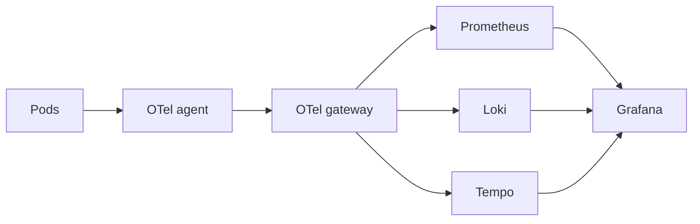

# Observability for ml-api and backend-api

**Status:** running on the local k3d cluster, deployed by Flux from this repo.

## Summary

When ml-api gets slow or backend-api starts throwing 500s, you want to know what broke and why without guessing. This setup collects metrics, logs and traces from every pod with OpenTelemetry, and stores them in Prometheus, Loki and Tempo. Grafana sits on top, so you can go from "latency went up" to the slow request and its logs in a couple of clicks. Every alert comes with a runbook, and two SLOs per service tell you when a problem is big enough to matter.

## Context and goals

Before this, the services exposed `/metrics`, wrote logs to stdout, and that was it. No traces, no dashboards, no alerts.

Goals:

- See the golden signals for both services, plus whatever runs out first (CPU, memory, the DB pool).
- Go from a metric to a trace to the log lines of a single request.
- Alert on what users feel, with a runbook for every alert.
- Track availability and latency against SLOs.
- Deploy everything with Flux, the same way as the apps.

Non-goals:

- Changing app code. Instrumentation, log config and scraping are all done from the outside.
- Production-grade storage. Loki and Tempo run on local disk (see [Known limitations](#known-limitations)).
- Keeping metrics longer than 30 days.

## Design

### Overview



If you want every arrow, the full drawing is in [docs/observability.excalidraw](docs/observability.excalidraw). Open it on excalidraw.com or with the VS Code extension.

### Collectors: agent + gateway

Everything a pod sends goes through two OpenTelemetry Collectors before it lands anywhere. That's the agent + gateway pattern from the [OTel docs](https://opentelemetry.io/docs/collector/deploy/gateway/).

- The **agent** is a DaemonSet. It takes OTLP from the pods on its node (over a `hostPort`), reads `/var/log/pods`, scrapes `/metrics`, adds Kubernetes metadata and passes it all on. Metrics and logs wait in a queue on disk, so a gateway restart doesn't lose them. The Target Allocator runs `per-node`, so each agent only scrapes the pods on its own node and nothing gets scraped twice.
- The **gateway** is a Deployment with an HPA. It holds the processing rules and the backend endpoints, so changing a filter means touching one Deployment instead of every node. The agent routes traces by trace ID, so a whole trace always lands on the same gateway replica. Tail sampling and the service graph both need that.

### Metrics

The agent scrapes ml-api and backend-api every 15s. The auto-instrumentation also pushes one histogram of its own to the agent over OTLP: `http.server.request.duration`, with trace IDs as exemplars. The agent sends both to the gateway, and the gateway writes them to Prometheus through its OTLP receiver. The scraped metrics keep the same names and `job`, `namespace` and `pod` labels as a normal Prometheus scrape. Cluster metrics (kube-state-metrics, cAdvisor, node-exporter) are still scraped by Prometheus itself.

### Traces

The apps had no tracing at all. Instead of touching their code, the OpenTelemetry Operator injects the Python auto-instrumentation through a pod annotation (FastAPI, psycopg2, urllib). Before any sampling, the gateway turns every span into span metrics and service graph metrics. Then tail sampling decides which traces to keep: every error, anything slower than 500ms, and a baseline. The baseline is a random share of all the other requests, so you still have normal, healthy traces to compare against. It's 100% on k3d (more on that in the tradeoffs). Tempo just stores the traces.

Why tail sampling and not head sampling? Head sampling decides when a request starts, before anyone knows how it will end. At 10%, it would throw away 9 out of 10 errors along with the boring requests. Tail sampling waits 10 seconds after a trace starts, which is plenty for a request to finish, then looks at what happened and decides. So the SDK sends every span, and the gateway makes the call. The price is that the gateway holds each trace in memory for those 10 seconds, and all spans of a trace have to reach the same gateway replica. That's why the agent routes traces by trace ID.

### Logs

ml-api and backend-api send their logs over OTLP straight from the process, so every line carries the `trace_id` of its request. Everything else is read from the pod log files. The gateway throws away successful `/health`, `/ready` and `/metrics` lines (nobody needs thousands of those) and keeps the failing ones.

One catch with uvicorn: OTel's log handler sits on the root logger ([OTel docs](https://opentelemetry.io/docs/zero-code/python/logs-example/)), but uvicorn's own loggers have `propagate: False` ([its default config](https://github.com/encode/uvicorn/blob/master/uvicorn/config.py)). So the access logs never got there. The fix is [apps/ml-api/uvicorn-log-config.json](apps/ml-api/uvicorn-log-config.json): it's uvicorn's default config with `propagate` set to true, passed in with uvicorn's standard `--log-config` flag. No code change, and stdout looks the same. The file has no `root` key on purpose, because `dictConfig` removes a logger's existing handlers when it configures it, and that would take the OTel handler with it.

### Tying the signals together

All three signals get the same service name, namespace, pod, cluster and environment, and that's what makes them line up in Grafana. Only a few of those become labels (`otlp.promoteResourceAttributes` in Prometheus, `otlp_config` in Loki), so cardinality stays low.

### Deployment

Flux applies `infra-controllers`, then `infra-configs`, then `apps`. The order matters: the Instrumentation CR has to exist before the app pods start, or they come up without tracing.

```
infrastructure/controllers/observability/   Helm charts, installed first
  kube-prometheus-stack/                    Prometheus, Alertmanager, Grafana, exporters
  loki/, tempo/                             single binary, local disk
  opentelemetry-operator/, sloth/
infrastructure/configs/observability/       everything that needs the CRDs above
  kube-prometheus-stack/                    alerts/, alertmanager/slack.yaml, dashboards/
  opentelemetry-operator/                   instrumentation.yaml
  opentelemetry-collector/                  rbac.yaml, agent/, gateway/
  sloth/slos/                               one file per service
apps/*/uvicorn-log-config.json
.github/workflows/flux-diff-preview.yaml
```

Each collector has a `base.yaml` plus one file per signal (`metrics.yaml`, `traces.yaml`, `logs.yaml`). Changing the log pipeline? You only touch `logs.yaml`. Kustomize merges them into one `OpenTelemetryCollector` CR.

On every PR, `flux-diff-preview` spins up a throwaway k3d cluster with Flux on `main`, adds any controllers the PR brings, and comments the `flux diff`. That way the CRD schemas and the prometheus-operator webhook catch a bad rule before it gets merged. Dashboards get a quick `jq` check.

## What I monitor, and why

- **Request rate, 5xx ratio and p50/p95/p99.** That's what users actually feel.
- **CPU, memory and the DB pool.** Whatever runs out first takes the service down with it.
- **Calls to dependencies.** When things get slow, the first question is always "is it us or Postgres?"
- **Predictions per second.** Proof that the ML API does real work and isn't just answering probes.
- **`ml_api_memory_bytes` next to container memory vs limit.** Catches a leak before the OOMKill does.
- **DB connections and query status.** The backend lives and dies by its pool and Postgres.
- **Pods up, restarts, availability.** Crashloops and failing liveness probes.
- **Error logs.** To get from "errors went up" to the actual exception.
- **Collector export failures.** Otherwise the first sign of trouble is an empty dashboard.

## Alerts

Every alert links to its section in [docs/runbooks.md](docs/runbooks.md), and the Slack message carries the link too. Whoever gets paged at 3am knows where to start.

| Alert | Fires when | Severity |
| --- | --- | --- |
| `ServiceDown` | ml-api, backend-api or postgres has 0 available pods for 1m | critical |
| `ServiceDegraded` | fewer pods available than desired for 5m | warning |
| `ScrapeTargetDown` | the agent can't scrape a pod for 2m | warning |
| `AppMetricsMissing` | no `up` series for an app for 5m, meaning the collectors are down | critical |
| `OtelExportFailing` | a collector exporter fails for 5m | warning |
| `PodRestarting` | more than 2 restarts in 15m | warning |
| `ContainerMemoryNearLimit` | working set above 85% of the limit for 5m | warning |
| `MLApiHighErrorRate`, `BackendApiHighErrorRate` | 5xx above 5% on `/predict` or `/process` for 5m | critical |
| `MLApiHighLatency` | `/predict` p95 above 1s for 5m (normally about 400ms) | warning |
| `BackendApiHighLatency` | `/process` p95 above 500ms for 5m | warning |
| `MLApiNoPredictions` | no predictions for 10m | warning |
| `MLApiMemoryGrowing` | `ml_api_memory_bytes` above 50MiB and still growing for 10m | warning |
| `BackendDbPoolExhausted` | a `pool_exhausted` query, or all 10 connections in use, for 1m | critical |
| `BackendDbConnectionsHigh` | 8 or more of 10 connections in use for 5m | warning |
| `BackendDbErrors` | more than 5% of DB queries fail for 5m | critical |

A few things behind those:

- Error and latency alerts only look at `/predict` and `/process`, so health checks don't water down the ratio.
- `BackendDbPoolExhausted` also checks the connection count. A full pool makes the pods NotReady, and the failed-query count alone would resolve too early.
- `AppMetricsMissing` takes about 10 minutes to fire, because Prometheus keeps the last sample for 5 minutes before the series counts as gone.
- The kube-prometheus-stack default rules are on too.

### Slack routing

An `AlertmanagerConfig` ([alertmanager/slack.yaml](infrastructure/configs/observability/kube-prometheus-stack/alertmanager/slack.yaml)) gives each team its own channel. `team="ml"` or the `ml-api` namespace goes to `#ml-alerts`, `team="backend"` or the `backend-api` namespace goes to `#backend-alerts`, and everything else (postgres, the collectors, the cluster) goes to `#platform-alerts`. App and SLO alerts set `team`. Platform alerts like `ServiceDown` only have a namespace, so they go to whoever owns it. `Watchdog` and `InfoInhibitor` stay out of Slack.

This config lives in `observability`, and by default the operator would only let it see alerts from that namespace. Alertmanager runs with `alertmanagerConfigMatcherStrategy: OnNamespaceExceptForAlertmanagerNamespace`, so this one config sees alerts from every namespace. Configs that teams add in their own namespace still only see their own alerts.

Slack is optional, and this cluster doesn't have one. The webhook URLs stay out of Git. Without the `alertmanager-slack` Secret, the operator skips this config and logs a warning. Alerts still show up in Alertmanager and Grafana, and nothing else breaks. To turn Slack on, create the Secret with one incoming webhook per channel:

```bash
kubectl -n observability create secret generic alertmanager-slack \
  --from-literal=platform=<webhook> --from-literal=ml=<webhook> --from-literal=backend=<webhook>
```

Please don't fill it with fake URLs to silence the warning. Every send would fail, and `AlertmanagerClusterFailedToSendAlerts` would fire as critical, which is a very loud way to get rid of a warning.

## SLOs

Thresholds are useful, but the question that really matters is "are we keeping our promise to users?" [Sloth](https://sloth.dev/specs/kubernetes/) answers it. It turns a short `PrometheusServiceLevel` spec into recording rules and multi-window, multi-burn-rate alerts, the way the Google SRE workbook describes. Each service gets the same two SLOs over 30 days:

| SLO | SLI | Objective | Error budget (30d) |
| --- | --- | --- | --- |
| ml-api availability | `/predict` without 5xx | 99.5% | 3.6h |
| ml-api latency | `/predict` under 500ms | 99% | 7.2h |
| backend-api availability | `/process` without 5xx | 99.5% | 3.6h |
| backend-api latency | `/process` under 100ms | 99% | 7.2h |

- A fast burn (the budget would be gone in about 2 days) pages as `critical`. A slow burn is a `warning`, the kind you handle in a ticket.
- I picked the thresholds from measurements, not gut feeling. `/predict` p95 is about 400ms, and today every request is under 500ms. `/process` p99 is about 10ms (it's one insert), so 100ms leaves plenty of room.
- The error queries end with `or vector(0)`. Without it, the SLI shows "no data" when there are no 5xx at all, which is exactly when you'd like to see a nice flat zero.

## Using it

### Getting in

```bash
kubectl -n observability port-forward svc/kube-prometheus-stack-grafana 3000:80   # admin / admin
kubectl -n observability port-forward svc/kube-prometheus-stack-prometheus 9090
kubectl -n observability port-forward svc/kube-prometheus-stack-alertmanager 9093
```

### Finding your way in Grafana

Open **Services > Service Overview (SLO)** and pick a service. Read it top to bottom: SLO status first, then the golden signals, then the dependencies, with collapsed rows for rollouts, logs and traces at the end.

**ML Services** has the RED and USE panels for ml-api, backend-api and Postgres (CPU, memory, the DB pool). The Kubernetes folder holds the [dotdc Kubernetes views](https://grafana.com/grafana/dashboards/15757), and the Platform folder has the kube-prometheus-stack defaults. The JSON lives in `infrastructure/configs/observability/kube-prometheus-stack/dashboards/`.

The fun part is hopping between signals:

- See a spike on a latency panel? Click an exemplar dot and you're in that request's trace.
- On a span, "Logs for this span" opens its log lines in Loki, matched on the trace ID.
- On an ml-api or backend-api log line, "View trace" takes you back to the trace.
- Tempo's service map shows who calls the service and what it calls. Postgres shows up there as `voize`, which is its database name.

Good to know:

- The `$service` variable comes from the Sloth SLOs. The same name is used for the Prometheus `job`, the namespace and the Loki `service_name`, so a new service shows up on its own as soon as it has an SLO file.
- Deploys show up as annotations, so you can tell right away if a problem started with a release.
- Each service has two duration histograms. The app's own one drives the SLOs and alerts. The SDK one is only there for exemplars, because `prometheus_client` can't send them without a code change.

## Alternatives and tradeoffs

These are the calls I made, what I picked them over, and what they cost:

- **Agent + gateway, not one DaemonSet.** One more hop and one more workload. In return the agent stays small, the rules live in one place, the gateway scales on its own, and tail sampling becomes possible. Is it more than a single-node k3d needs? Yes. But the layout won't have to change when the cluster grows.
- **Collectors push app metrics, instead of Prometheus scraping them.** One pipeline for every signal, and Prometheus only needs its OTLP receiver, so remote-write stays off. The catch is that the apps' `up` now comes from the agent. If the collectors die, the series quietly disappear instead of dropping to 0. `AppMetricsMissing` uses `absent()` to catch that, and `ServiceDown` uses kube-state-metrics, which Prometheus still scrapes itself.
- **Span metrics in the gateway, not Tempo's metrics-generator.** The `span_metrics` and `service_graph` connectors see every span before sampling, so the sampling rate doesn't skew them. Each gateway replica counts its own share of spans, so the series carry a `collector_pod` label. Without it, replicas would write the same series and break the counters. Queries sum it away.
- **100% tail sampling on k3d, about 10% in production.** At a few spans per second, keeping everything costs nothing. Exemplars are picked before sampling, so at 10% most dots for normal requests would point to dropped traces (when I tried it, only 1 in 30 still had its trace). Errors and slow requests are always kept, and those are the dots worth clicking anyway.
- **30 days in Prometheus, no Thanos or Mimir.** 30 days means the SLO window always has full data. An 18GB size cap on a 20Gi volume drops the oldest blocks first, and it grows by about 13MB an hour here. Loki keeps 7 days and Tempo 3. Going past 30 days is when Thanos or Mimir would be worth it.
- **Two log paths, not just pod log files.** Only the Python apps get trace IDs in their logs, and that needs the uvicorn `--log-config` described under [Logs](#logs). Everything else still goes through the pod log files, without trace IDs.
- **One file per signal for each collector, not the collector's multiple `--config` files.** The operator needs the whole config in `spec.config` to build the Service ports and the Target Allocator config, so Kustomize merges the files into one CR instead.
- **Threshold alerts next to SLO burn alerts, for now.** Thresholds tell you something is broken right now, and the burn rate tells you whether it matters for the month. Once the SLOs are tuned, I'd drop the threshold ones.

## Known limitations

- **SLIs are measured inside the app.** There's no ingress or mesh to measure at. The blind spot: if every pod is NotReady, requests never reach the app and the SLO doesn't burn. That's exactly what happened with the backend connection leak. `ServiceDown` covers it, and the load-generator's client spans show it. In production I'd measure at the ingress.
- **Laptop-sized backends.** Loki and Tempo run as single binaries on local disk, the gateway starts at 1 replica, and there's no ingress (port-forward only). In production that becomes S3 and scalable mode, plus at least 2 gateway replicas with a PodDisruptionBudget.
- **Postgres runs on an `emptyDir`.** Found on day one: it had restarted, which wiped the `documents` table. The backend only creates it at startup, so every `/process` returned 500. The fix is a PVC for Postgres, or a migration job that creates the table.
- **`NodeClockNotSynchronising` always fires on k3d** with Docker Desktop, because the VM clock isn't NTP-synced. On real nodes it's a valid alert, so I left it alone.

## Future work

My wish list, roughly in order:

- A PVC for Postgres (the bug above)
- Slack webhooks and the Grafana admin password from SOPS-encrypted Secrets, and PagerDuty for `critical`
- SLOs from the caller side (load-generator client spans) to cover the NotReady blind spot
- postgres-exporter for database metrics
- Exemplars on the app histograms (a small code change), then drop the SDK histogram
- Pyroscope for profiling (its eBPF agent doesn't run on Docker Desktop)
- Right-sized requests and limits from real usage (VPA in recommend mode)
